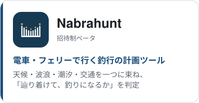
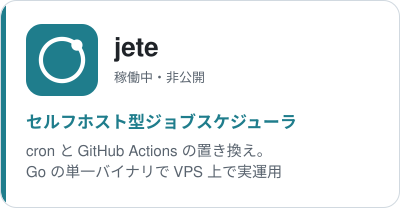
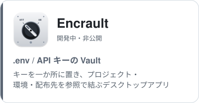
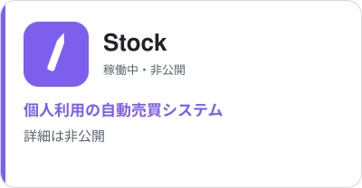

# tmhiroak

バックオフィスの AI 活用推進を本業にしています。日々の仕事で感じた不便や非効率を、Claude CodeとCodex を使った個人開発のプロダクトで解決しています。
最近､Orcaを使って､Claude CodeとCodexを協業させて､開発しています｡

作るだけでなく、動かし続けることを大事にしています。ジョブスケジューラ（jete）で定期処理を回し、Cloudflare Workers と Healthchecks.io で外から監視し、障害は公開ステータスページで知らせるところまで、個人の規模で一通り自分で回しています。

## プロダクト

<a href="https://statuspage.incident.io/tmhiroak-products"><picture><source media="(prefers-color-scheme: dark)" srcset="assets/status-button-dark.svg"></picture></a>

<a href="https://nabrahunt.com"><picture><source media="(prefers-color-scheme: dark)" srcset="assets/card-nabrahunt-dark.svg"></picture></a>
<a href="https://statuspage.incident.io/tmhiroak-products"><picture><source media="(prefers-color-scheme: dark)" srcset="assets/card-jete-dark.svg"></picture></a>
<a href="https://statuspage.incident.io/tmhiroak-products"><picture><source media="(prefers-color-scheme: dark)" srcset="assets/card-encrault-dark.svg"></picture></a>
<a href="https://statuspage.incident.io/tmhiroak-products"><picture><source media="(prefers-color-scheme: dark)" srcset="assets/card-stock-dark.svg"></picture></a>

## 使っている技術

| 領域 | 技術 |
|---|---|
| 言語 | Go / TypeScript / Python / Rust |
| ランタイム・FW | Node.js / Tauri v2 / Vite / htmx |
| データ | SQLite / Litestream / BigQuery / Cloudflare R2 |
| インフラ | Docker Compose / Cloudflare（Workers・Tunnel・Access・Pages）/ GCP / VPS / systemd / Tailscale |
| 外部 API | Open-Meteo / 気象庁 / 駅すぱあと / ODPT / OpenStreetMap / J-Quants / EDINET / SEC EDGAR / API Ninjas |
| 認証・通知 | Passkey（WebAuthn）/ LINE・Google・GitHub ログイン / Cloudflare Turnstile / Resend / Web Push / Discord |
| 監視・運用 | Healthchecks.io / incident.io / Cloudflare Workers / Prometheus |
| セキュリティ | gitleaks / Semgrep / cargo-deny / OSV / Landlock / age |
| AI・開発 | Claude Code / Codex / Orca / Claude Agent SDK / MCP / Groq / Ollama |

## 連絡先
[X](https://twitter.com/tmhiroak) · [LinkedIn](https://www.linkedin.com/in/tmhiroak)
